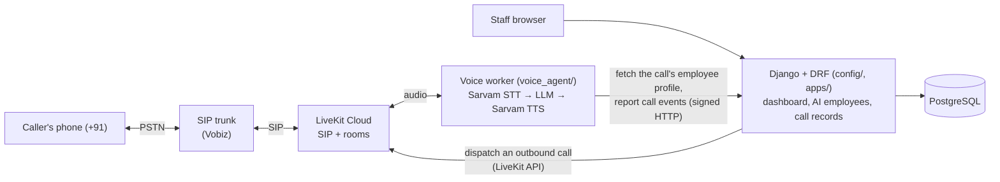
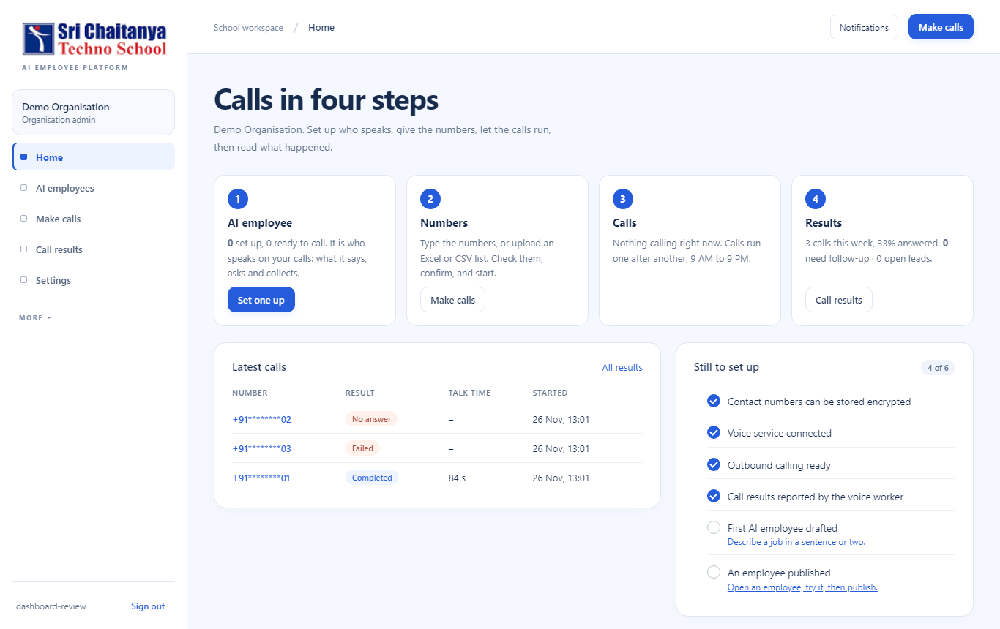
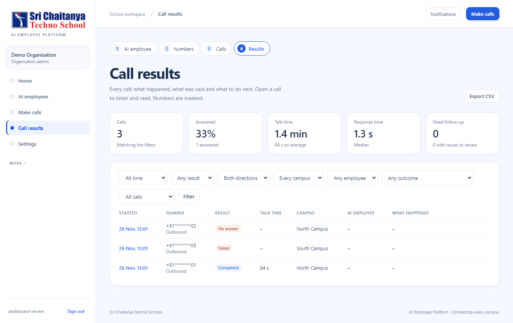

# Vaani — Universal Voice Agent

A configurable voice-agent workspace for businesses: customer support, sales
enquiries, appointment reminders and other workflows defined by the user.
Each organisation supplies its own name, locations, knowledge and AI employee
instructions. No school or institution is built into the shared instructions.

The current voice stack supports Telugu, English and mixed Telugu-English,
with inbound and outbound calling on Indian (+91) numbers.

To adapt the workspace to your business, create your organisation and locations,
add its approved facts under **Knowledge**, then use **AI employees → Create AI
employee** to describe the job. Review the greeting, instructions and limits,
try a preview, and publish when ready. The next-step card on Home guides this flow.

**Status: outbound calling and the dashboard work. Incoming-call routing is
implemented, but the current Vobiz trial number cannot receive incoming calls.**
The local setup still needs a purchased incoming number, secure provider routing,
and a LiveKit inbound trunk and dispatch rule. Follow the
[incoming-call setup guide](docs/VOBIZ_SETUP.md). Nothing is deployed.

## Start this existing workspace

For everyday local use, open two PowerShell terminals. Run the dashboard in the
first:

```powershell
Set-Location -LiteralPath 'C:\Users\Sandeep.J\Documents\agent'
.\.venv\Scripts\python.exe -X utf8 manage.py runserver 127.0.0.1:8002
```

Run the voice worker in the second:

```powershell
Set-Location -LiteralPath 'C:\Users\Sandeep.J\Documents\agent'
.\.venv\Scripts\python.exe -X utf8 -m voice_agent.agent dev
```

Keep both terminals open and visit <http://127.0.0.1:8002/home/>. Reuse an existing
running server or worker instead of starting a duplicate. Stop a process with
`Ctrl+C` in its terminal when no call is active. Restart both after changing
`.env.local`; this worker command does not reload code automatically.

Start on Home and follow **Your next step**. For outgoing calls: publish an AI
employee, check the numbers in **Make calls**, start the list, then review **Call
results**. A failed or unanswered outgoing call has **Call again**, so its details
do not need to be entered again. Without Celery running, keep the call-list page
open while a list is calling. Use **Analyse now** on a completed call if its
summary is still waiting for a background job.

Incoming calls are optional and can be configured later. Their incomplete setup
does not prevent a configured outgoing line from working. The installation steps
below are for a new machine; do not overwrite an existing `.env.local` or create
another account for each restart.

| Document | What it covers |
| :--- | :--- |
| [docs/DASHBOARD.md](docs/DASHBOARD.md) | The staff dashboard: AI employees, making calls, call records and how the worker reports them |
| [docs/VPS_DEPLOYMENT.md](docs/VPS_DEPLOYMENT.md) | Shared Ubuntu VPS: automated deployment beside EduNexa, Nginx/SSL, updates and separate LiveKit worker |
| [docs/DEPLOYMENT.md](docs/DEPLOYMENT.md) | Deployment architecture and dedicated-server alternative |
| [docs/DEPLOYMENT_MEASUREMENTS.md](docs/DEPLOYMENT_MEASUREMENTS.md) | Initial local image sizes, container tests and workload results |
| [docs/DISASTER_RECOVERY.md](docs/DISASTER_RECOVERY.md) | Backups, restore drill and recovery runbooks |
| [docs/INBOUND.md](docs/INBOUND.md) | Inbound routing, call lifecycle, and the transfer design |
| [docs/OUTBOUND_TEST.md](docs/OUTBOUND_TEST.md) | The first real call: one outbound test call to your own mobile |
| [docs/VOBIZ_SETUP.md](docs/VOBIZ_SETUP.md) | Step-by-step account, number and trunk setup for the first real inbound call |
| [docs/RECORDINGS.md](docs/RECORDINGS.md) | Call recordings: how they work, consent, storage in India, costs, and the steps for a first recorded test call |
| [docs/CONTACT_KEYS.md](docs/CONTACT_KEYS.md) | Backing up, recovering and rotating the keys that protect stored phone numbers |
| [docs/CALL_TERMINATION_DESIGN.md](docs/CALL_TERMINATION_DESIGN.md) | Goodbye and hang-up behaviour, off unless `AGENT_CAN_END_CALL=true` |
| [docs/VOICE_TUNING.md](docs/VOICE_TUNING.md) | Voice responsiveness checkpoint: turn-taking and interruption settings |
| [docs/FEATURE_MATRIX.md](docs/FEATURE_MATRIX.md) | Feature-by-feature comparison with the reference product, and what is still missing |
| [docs/PILOT_READINESS.md](docs/PILOT_READINESS.md) | Acceptance and pilot readiness for a configured organisation |
| [docs/ROADMAP.md](docs/ROADMAP.md) | Full incoming/outgoing calling roadmap, Phases 1–5 |
| [docs/adr/0001-two-process-boundary.md](docs/adr/0001-two-process-boundary.md) | Why the voice worker and Django are separate processes |
| [docs/history/](docs/history/) | Records of finished phases: the Phase 0 audit, Phase 1 and 1.5 verification, the Phase 2 plan and implementation, and the dashboard build log |

## How it is put together

Two processes that are started and deployed separately:

| Process | Code | Does |
| :--- | :--- | :--- |
| Voice worker | `voice_agent/` | LiveKit Agents: Sarvam STT, LLM, Sarvam TTS, turn-taking |
| Django backend | `config/`, `apps/` | Django + DRF: the dashboard (AI employees, Make calls, call results, settings), the worker's signed APIs and the health API |

The worker never imports Django and Django never imports the voice stack. A test
enforces this.



| Home: calls in four steps | Call results |
|---|---|
|  |  |

Screenshots from the disposable QA server (`python -m tests.browser.dashboard_server`): made-up organisation, locations and phone numbers.

## Setup on Windows

Run these in PowerShell from the repository folder.

**1. Install the tools** (once per machine):

```powershell
winget install astral-sh.uv
winget install LiveKit.LiveKitCLI
```

Close and reopen PowerShell so `uv` and `lk` are on your PATH, then check. `lk agent`
commands run the worker through `uv`, so `uv` must be on PATH: without it they fail
with "livekit-agents is not installed in the project environment".

```powershell
uv --version      # 0.13 or later
lk --version      # 2.19 or later
```

**2. Install dependencies.** uv downloads Python 3.12 if needed and creates `.venv`:

```powershell
uv sync
```

**3. Create your settings file:**

```powershell
Copy-Item .env.example .env.local
```

**4. Connect LiveKit Cloud.** Create a free project at <https://cloud.livekit.io>, then:

```powershell
lk cloud auth
lk app env --write --destination .env.local
```

This opens a browser to sign in and writes `LIVEKIT_URL`, `LIVEKIT_API_KEY` and
`LIVEKIT_API_SECRET` into `.env.local`.

**5. Add your Sarvam key.** Get one at <https://dashboard.sarvam.ai>, open `.env.local`
and set `SARVAM_API_KEY=`.

That is everything the default configuration needs. The LLM runs through LiveKit
Inference on your LiveKit project, so no OpenAI key is required. To use OpenAI
directly, set `LLM_PROVIDER=openai` and `OPENAI_API_KEY`.

**6. Make the terminal Telugu-safe.** Use Windows Terminal, and in each new session:

```powershell
$env:PYTHONUTF8 = "1"
```

Without this, Telugu text in logs can fail to print in older consoles.

## Run the voice worker

Talk to it with your microphone and speakers (headphones recommended):

```powershell
lk agent console voice_agent/agent.py
```

Keys while it runs: `m` mutes the microphone, `Ctrl+T` switches to typing, `q` quits.
Add `--record` to save the audio under `console-recordings/`, `--text` to start in
typing mode, and `--list-devices` to see audio devices.

Other ways to run it:

```powershell
lk agent dev voice_agent/agent.py            # connect to LiveKit Cloud, hot reload
lk agent debugger start voice_agent/agent.py # text turns from a script; then:
lk agent debugger say "నమస్తే, నాకు appointment కావాలి"
lk agent debugger stop
uv run voice_agent/agent.py start            # production mode
```

To talk to one of your AI employees without a phone call, point
`CONSOLE_PROFILE_FILE` in `.env.local` at a JSON file holding its profile
(`{"agent_profile": {...}}`, as Django sends it). Console and debugger sessions
then play that employee. A dispatched call never reads the file.

After a conversation, summarise the measured latency:

```powershell
uv run python scripts/latency_report.py
```

## Run the dashboard

Use the existing virtual environment directly; global `uv` is not needed to run it.
In PowerShell from this repository:

```powershell
.\.venv\Scripts\python.exe manage.py migrate
.\.venv\Scripts\python.exe manage.py createsuperuser
.\.venv\Scripts\python.exe manage.py runserver 127.0.0.1:8002
```

Skip `createsuperuser` if you already have a Django account. In another window,
start the worker, which places and answers the calls:

```powershell
$env:PYTHONUTF8 = "1"
.\.venv\Scripts\python.exe -m voice_agent.agent dev
```

Open <http://127.0.0.1:8002/> and sign in; it opens Home. This workspace's worker
callbacks in `.env.local` use port 8002. If you choose another port, update
`CALL_EVENTS_URL`, `CALL_PROFILE_URL`, `CALL_RECORDING_URL` and
`INBOUND_CONTEXT_URL` together before restarting the worker.

To skip the login page on your own machine, put your username in `.env.local`:
`DEV_AUTO_LOGIN_USER=YOUR_USERNAME`. Browsers on this computer then open the
dashboard already signed in. It works only with `DJANGO_DEBUG=true` and only
for requests from this computer. Django refuses to start with it when
`DJANGO_DEBUG=false`. Signing out signs you straight back in; to try another
account, clear the setting and restart Django.

Both processes use the existing `.env.local`. Django needs `LIVEKIT_URL`,
`LIVEKIT_API_KEY`, `LIVEKIT_API_SECRET`, and the same `AGENT_NAME` as the worker.
API secrets stay on the server.

The health API is at <http://127.0.0.1:8002/api/health/>. It checks Django and the
database, not the separate voice worker; check the worker terminal for its
registered-worker message.

## Everyday use: calls in four steps

After signing in, the sidebar shows the four steps first:

1. **AI employees:** who speaks. Hire one from a short description, edit it,
   then publish. To hear it, press **Make calls** on its page and call your
   own number.
2. **Make calls:** type numbers (one per line, with a name if you like) or
   upload an Excel/CSV list with a Phone (or Mobile) column and an optional
   Name column. A list holds up to 500 people; split a bigger file.
   - Click **Check numbers**. Rows that are not Indian mobile numbers are
     listed with the reason, and repeated numbers are kept once.
   - Tick that everyone agreed to be called, then **Start calling**.
3. **Calls:** the list page shows each person's status live. The AI calls one
   person at a time, between 9 AM and 9 PM, skipping the do-not-call list.
   Pause, resume or cancel at any time. Keep the page open, or run Celery so
   calls continue in the background.
4. **Call results:** every call, with its recording (if switched on),
   conversation, summary and next step.

**Workspace tools** contains Leads & contacts, Knowledge and Incoming calls.
**Settings → Setup & reports** contains Locations & team, Numbers & channels,
Performance, Usage & costs and Operations.

Who can be called follows `OUTBOUND_DIALING_MODE`:
- `live`: any valid Indian mobile, after the confirmation above.
- `allowlist`: only `OUTBOUND_ALLOWLIST_NUMBERS`; other rows show
  "Could not call" with the reason.

## Dashboard and call records

Staff sign in at <http://127.0.0.1:8002/home/> to hire and publish AI employees,
place calls and read call results. Phone numbers are displayed in full within the user's
workspace permissions and stored encrypted. Call results include timings, SIP status
and latency. Failed or unanswered outbound calls offer **Call again**, reusing the
original details and preserving the earlier attempt. The full guide, including
how the worker reports calls back to Django, is in
[docs/DASHBOARD.md](docs/DASHBOARD.md).

## Inbound telephony

These commands buy nothing and place no call. The first three change nothing:

```powershell
.\.venv\Scripts\python.exe manage.py telephony plan              # no network
.\.venv\Scripts\python.exe manage.py telephony status            # lists LiveKit SIP config
.\.venv\Scripts\python.exe manage.py telephony apply --dry-run   # what apply would create
.\.venv\Scripts\python.exe manage.py telephony apply --confirm-number +91XXXXXXXXXX --yes-change-livekit
```

`plan` shows the inbound trunk and dispatch rule that would be created and every
blocker in the way. Unverified provider or LiveKit capabilities are blockers until you
list them in `TELEPHONY_CONFIRMED`. `apply` creates the LiveKit trunk and dispatch rule
only when the plan has no blockers; `teardown` removes them. Settings are under
"Inbound telephony" in [.env.example](.env.example). Follow
[docs/VOBIZ_SETUP.md](docs/VOBIZ_SETUP.md) for the first real call.

## Change the voice, model or language

Edit `.env.local` and restart the worker. Every setting is described in
[.env.example](.env.example). The ones you are most likely to change:

| Setting | Default | Meaning |
| :--- | :--- | :--- |
| `SARVAM_TTS_SPEAKER` | `kavitha` | Voice. An invalid name is rejected at startup with the valid list |
| `SARVAM_TTS_PACE` | `1.0` | Speaking speed, 0.3 to 3.0 |
| `SARVAM_STT_LANGUAGE` | `te-IN` | `auto` detects the language per utterance |
| `SARVAM_STT_TASK` | `codemix` | Keeps English words in Latin letters inside Telugu text |
| `SARVAM_STT_MODE` | `standard` | `realtime` uses `saaras:v3-realtime` (needs a Sarvam realtime plan) |
| `LLM_PROVIDER` / `LLM_MODEL` | `livekit` / `google/gemma-4-31b-it` | Which LLM answers |
| `TURN_DETECTION` | `vad` | How the agent decides you have finished speaking |
| `TURN_ENDPOINTING_MIN_DELAY` | `0.5` | Seconds of silence before it replies |
| `AGENT_GREETING` | Telugu greeting | First thing the agent says |

The prompt is in `voice_agent/prompts/__init__.py` and the Telugu style sheet in
`voice_agent/grammar/te_style.md`. Together they must stay under 2.3 kB; a test
checks it.

An AI employee's own instructions (name, purpose, steps, details to collect,
limits and ending) may take up to `EMPLOYEE_INSTRUCTION_BYTES` (default 6144
bytes, about 2,000 Telugu letters, since a Telugu letter takes three bytes and an
English letter one). The editor shows the size as you type, using the same
count as the server. A longer draft can be saved and shortened later, but it
cannot be published. The worker's
`AGENT_PROFILE_BUDGET_BYTES` (default 8192) must be at least that plus 2048, for
the caller's context and notices. Facts belong in **Knowledge**.

## Tests and linting

```powershell
.\.venv\Scripts\python.exe -m pytest
.\.venv\Scripts\python.exe -m ruff check .
.\.venv\Scripts\python.exe -m ruff format .
```

The tests need no API keys and no network.

Conversation scenarios in `scenarios.yaml` run on LiveKit Cloud and use real inference:

```powershell
lk agent simulate text --scenarios scenarios.yaml --concurrency 1 voice_agent/agent.py
```

`--concurrency 1` is needed on the Windows development machine, where parallel local
sessions failed to connect in time.

In CI, `.github/workflows/simulations.yml` runs them after each merge to `main` when the repository
has the `LIVEKIT_URL`, `LIVEKIT_API_KEY`, `LIVEKIT_API_SECRET` and `SARVAM_API_KEY` secrets. Without
them the run is skipped with a warning (a run started by hand fails instead), so a skipped run is
never reported as a pass. To compare LLMs on the agent's prompt:

```powershell
uv run python scripts/llm_bakeoff.py google/gemma-4-31b-it openai/gpt-5.4-mini
```

### If `pytest` or `ruff` stop working on this machine

On the development machine, `pytest.exe` and `ruff.exe` were removed from
`.venv\Scripts` shortly after being run, most likely by security software.
Use `uv run python -m pytest` (as above), which is not affected. If ruff reports
"program not found", restore it with:

```powershell
uv sync --reinstall-package ruff
```

Ask IT to exclude the project's `.venv` folder if this keeps happening.

### Browser tests

```powershell
# Python: unit, API and cross-process tests (no network, no calls)
.\.venv\Scripts\python.exe -m pytest

# Same suite against PostgreSQL (needs the compose database running)
$env:TEST_DATABASE_URL = "postgres://telugu_agent:<password>@127.0.0.1:5432/telugu_agent"
.\.venv\Scripts\python.exe -m pytest
Remove-Item Env:TEST_DATABASE_URL

# Dashboard and Hire wizard in Chromium (canned LLM answer; restart the server per run)
.\.venv\Scripts\python.exe -m tests.browser.dashboard_server   # window 1
node tests/browser/dashboard.cjs                               # window 2
node tests/browser/crm.cjs                                     # window 2, same server
node tests/browser/calling.cjs                                 # after restarting the server
node tests/browser/make_calls.cjs                              # window 2, same server
node tests/browser/screens.cjs                                 # window 2, same server
node tests/browser/platform.cjs                                # Milestone E, after restarting again
```

The browser QA server sets fake numbers and credentials before Django starts, so it
cannot place a real call. It uses a disposable database under `.test-tmp/`.

## Troubleshooting

| Symptom | Cause and fix |
| :--- | :--- |
| `Voice agent configuration error: SARVAM_API_KEY is not set` | `.env.local` is missing or the key is blank |
| `ws_url is required, or set LIVEKIT_URL` | Step 4 was skipped |
| `SARVAM_TTS_SPEAKER=... is not a bulbul:v3 voice` | Pick a name from the list in the message |
| Agent replies "క్షమించండి, ప్రస్తుతం చిన్న సాంకేతిక సమస్య ఉంది" | The LLM or STT call failed; the log line `pipeline error` has the reason (often an invalid key or no credit) |
| Agent cuts you off while you think | Raise `TURN_ENDPOINTING_MIN_DELAY`, for example to `0.8` |
| Agent stops talking at background noise | Use headphones; raise `INTERRUPTION_MIN_DURATION` |
| `STTRealtime` fails to connect | Your Sarvam plan lacks realtime access; keep `SARVAM_STT_MODE=standard` |
| `lk` or `uv` not recognised | Reopen PowerShell after installing |
| `livekit-agents is not installed in the project environment` | `uv` is not on PATH; `winget install astral-sh.uv` and reopen PowerShell |
| Simulations fail with `No agent joined room within 30s` | Add `--concurrency 1` |

## Project layout

```text
voice_agent/          LiveKit worker (separate process)
  agent.py            entrypoint
  assistant.py        the agent: instructions and greeting
  config.py           environment -> validated settings
  pipeline.py         builds STT, LLM, TTS and turn handling
  observability.py    logging, per-turn latency, spoken error fallback
  prompts/  grammar/  system prompt and Telugu style sheet
config/               Django project (settings, urls, asgi)
apps/core/            health API, navigation, shared templates and static assets
apps/telephony/       telephony: trunk planning, outbound calls, call records, worker APIs
apps/workforce/       AI employees: hire wizard, LLM drafting, draft editor, dashboard home
apps/tenancy/         organisations, locations, roles and scope, access log
apps/crm/             encrypted contacts, leads, follow-ups, import, reports, retention
apps/calling/         Make calls lists, numbers, inbound routing, knowledge, call results, recordings
apps/integrations/    outside-request safety (transport, safety); old integration tables, kept for their data
apps/operations/      background jobs, notifications, usage, operations, readiness
deploy/               shared Nginx / dedicated Caddy compose, production images
scenarios/            proposed scenarios that are not yet run in CI
scripts/              deployment, health, backup/recovery, latency and LLM reports
tests/                django/, voice/, test_process_boundary.py
scenarios.yaml        LiveKit simulation scenarios
docs/                 audit, verification report, ADR
```

## Credits

The worker scaffolding (project layout conventions, `Dockerfile`, CI workflows,
`AGENTS.md`) is adapted from
[livekit-examples/agent-starter-python](https://github.com/livekit-examples/agent-starter-python)
(MIT, Copyright LiveKit, Inc.).

## License

[MIT](LICENSE).
